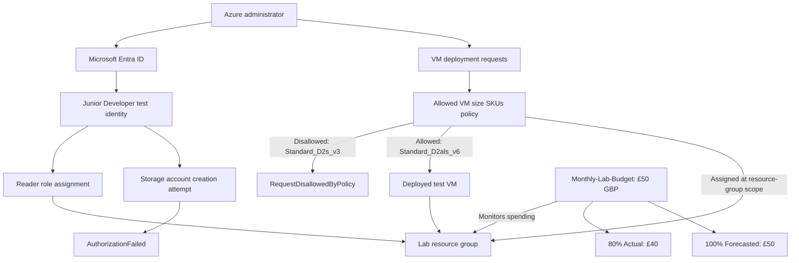
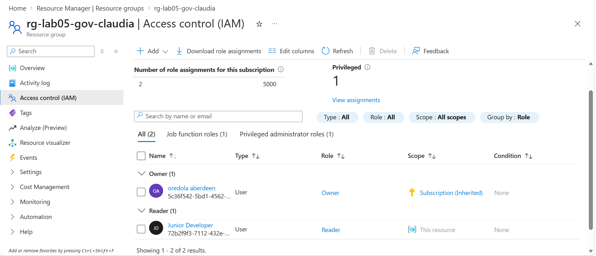
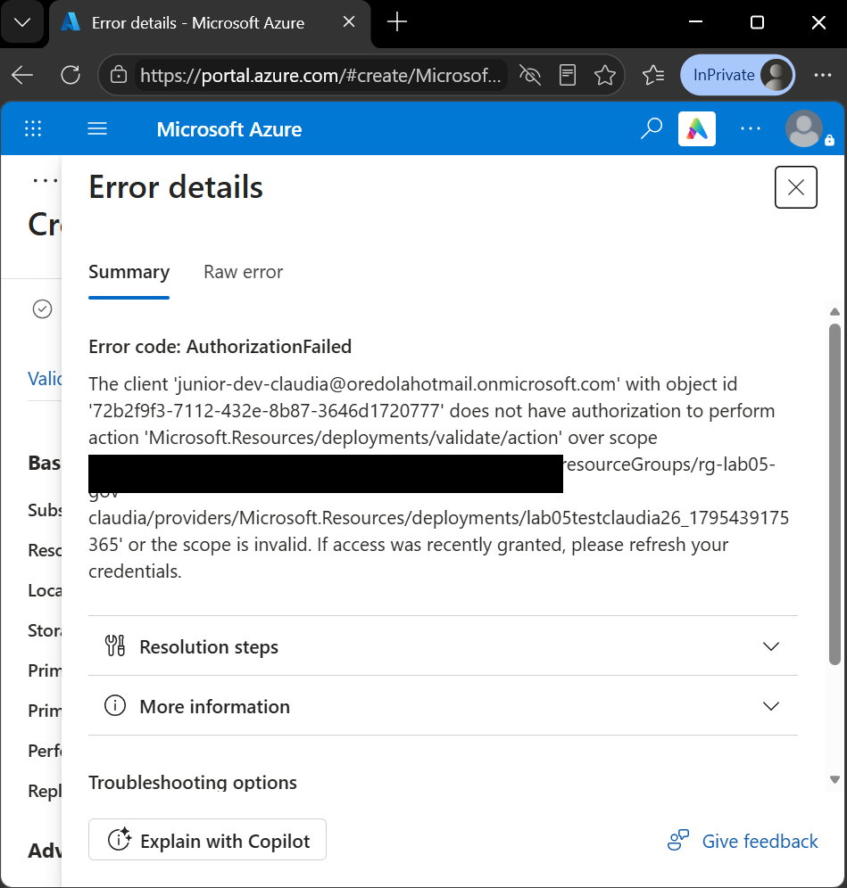
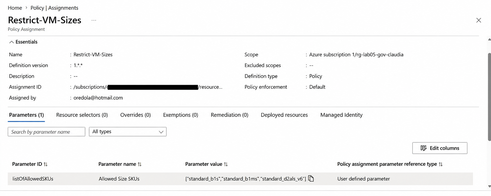
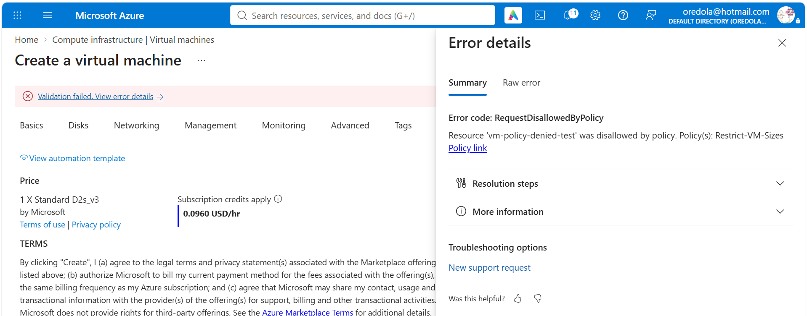
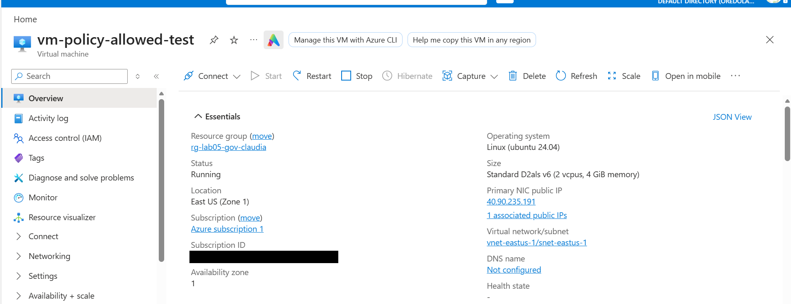
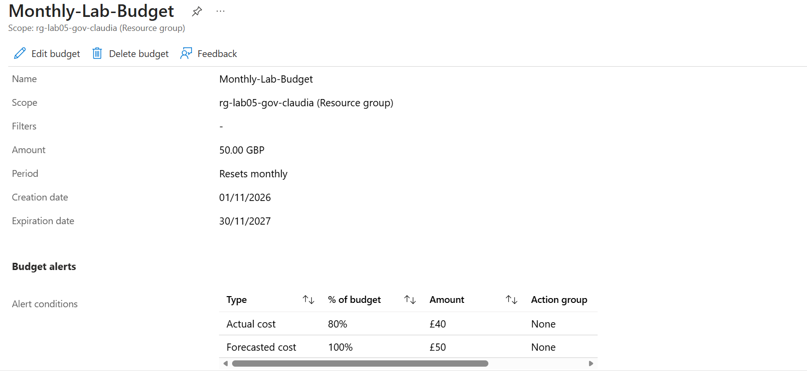

# Azure Lab 05 — Governance and Security Hardening

**Azure RBAC · Microsoft Entra ID · Azure Policy · Cost Management**

## Overview

This hands-on lab implements three complementary Azure governance controls within a dedicated resource group:

1. **Access control:** assign a test identity the built-in **Reader** role and test a restricted operation.
2. **Configuration control:** enforce an Azure Policy that permits only selected virtual machine (VM) sizes, then test both denied and permitted deployments.
3. **Cost visibility:** configure a monthly budget with actual-spend and forecasted-spend alert thresholds.

The lab also covers resource cleanup. The implementation was carried out in the Azure portal, with screenshots captured at key checkpoints.

> **Evidence convention:** Screenshots document the state at the time they were captured. Later deletion of lab resources and the test identity was confirmed by the lab operator but was not independently established by post-deletion screenshots.

## Architecture

**Control boundaries:** RBAC governs *who can perform operations*; Azure Policy governs *which resource configurations are permitted*; Cost Management budgets provide *spending visibility and notifications*. A budget does **not** prevent deployments, cap spending, or automatically shut down resources.

## Lab environment

| Setting | Implemented value |
|---|---|
| Cloud platform | Microsoft Azure |
| Region | East US |
| Resource group | `rg-lab05-gov-claudia` |
| Test identity | Junior Developer (Microsoft Entra ID) |
| RBAC role | Reader, scoped to the lab resource group |
| Policy assignment | `Restrict-VM-Sizes` |
| Policy definition | Built-in **Allowed virtual machine size SKUs** |
| Allowed VM SKUs | `Standard_B1s`, `Standard_B1ms`, `Standard_D2als_v6` |
| Budget | `Monthly-Lab-Budget` |
| Budget amount | **£50 GBP**, monthly |

## 1. Create an isolated governance scope

1. Sign in to the [Azure portal](https://portal.azure.com/) using an account authorised to create the lab resources.
2. Open **Resource groups** and create `rg-lab05-gov-claudia` in **East US**.
3. Use this resource group as the scope for the RBAC assignment, Azure Policy assignment and budget. Keeping the controls scoped to the lab resource group avoids applying them across the entire subscription.

## 2. Configure and test role-based access control

### Configuration

1. Create a **Junior Developer** test user in **Microsoft Entra ID**.
2. Open `rg-lab05-gov-claudia` → **Access control (IAM)** → **Add role assignment**.
3. Select the built-in **Reader** role and assign it to the Junior Developer identity at **resource-group scope**.
4. Use a separate private browser session to sign in as the test identity and attempt to create a storage account in the lab resource group.

### Result

The attempted operation returned **`AuthorizationFailed`**, with the error identifying a denied `Microsoft.Resources/deployments/validate/action` operation. This provides evidence that the attempted deployment validation was blocked under the test identity's effective permissions; it is not a comprehensive test of every possible Reader operation.

## 3. Enforce permitted VM sizes with Azure Policy

### Configuration

1. In **Azure Policy**, select the built-in **Allowed virtual machine size SKUs** definition.
2. Assign the definition to `rg-lab05-gov-claudia` with assignment name **`Restrict-VM-Sizes`**.
3. Set policy enforcement to **Default** (enabled), using the policy's deny behaviour for disallowed sizes.
4. Configure the final allowed SKU list:
   - `Standard_B1s`
   - `Standard_B1ms`
   - `Standard_D2als_v6`

### Negative test — disallowed size

Attempt to deploy a VM using **`Standard_D2s_v3`**, which is not on the allowed list. Azure returned **`RequestDisallowedByPolicy`**, referencing the `Restrict-VM-Sizes` assignment. The VM was not successfully deployed.

### Positive test — allowed size

A VM named **`vm-policy-allowed-test`** using **`Standard_D2als_v6`** and **Ubuntu 24.04** was successfully deployed and shown in **Running** state. This demonstrates that the policy permitted a listed size, not merely that it blocked a disallowed one.

### Troubleshooting and design decision

The original lab instructions proposed B-series VM sizes. Those sizes were unavailable for the selected deployment combination in this environment. Rather than removing the original B-series entries, I **added `Standard_D2als_v6`** to the allow-list and used it for the positive deployment test.

The final list therefore contained **three SKUs**, as shown in the policy screenshot. The denied test remained `Standard_D2s_v3`.

## 4. Configure Azure Cost Management

Within the lab resource group, create the following budget under **Cost Management → Budgets**:

| Budget setting | Configured value |
|---|---|
| Name | `Monthly-Lab-Budget` |
| Scope | `rg-lab05-gov-claudia` |
| Amount | **£50.00 GBP** |
| Reset period | Monthly |
| Actual-spend threshold | **80% = £40.00** |
| Forecasted-spend threshold | **100% = £50.00** |

**Calculation:** `£50 × 0.80 = £40`; `£50 × 1.00 = £50`.

The budget and its two thresholds were visible in Azure and captured in the screenshot below. **No evidence was collected that either threshold was reached or that an email notification was delivered.**

> **Important:** An Azure budget is a monitoring and notification mechanism. It does not enforce a hard spending limit or automatically delete or stop resources.

## 5. Evidence summary

| Test or configuration | Evidence-supported outcome |
|---|---|
| Reader role assignment | Visible at lab resource-group scope |
| Restricted storage account attempt | `AuthorizationFailed` during deployment validation |
| VM size policy | `Restrict-VM-Sizes` assignment with three allowed SKUs |
| Disallowed VM size | `Standard_D2s_v3` blocked by `RequestDisallowedByPolicy` |
| Allowed VM size | `Standard_D2als_v6` VM shown Running |
| Cost Management | £50 GBP monthly budget with 80% Actual and 100% Forecasted thresholds |

The evidence does **not** establish budget alert delivery, MFA enforcement, every possible Reader permission boundary, or independent post-cleanup absence checks.

## 6. Cleanup

After testing, I deleted the temporary approved VM, the lab resource group, the Junior Developer test identity and the governance assignments. **These deletions are operator-confirmed; post-cleanup absence screenshots or audit records were not collected.**

The budget and its alerts were no longer visible during cleanup. Because the budget was scoped to the deleted resource group, its disappearance is consistent with removal of that scope; the available evidence does not independently establish the precise deletion sequence or rule out leftover resources elsewhere in the subscription.

For a repeat of this lab, check for remaining managed disks, network interfaces and public IP resources, and separately verify deletion of the tenant-level test identity.

## 7. Key lessons

- **RBAC and Azure Policy solve different problems.** Reader access restricts operations by identity; a VM-size policy restricts configuration choices within its assigned scope.
- **Test both failure and success paths.** The policy denial and successful allowed deployment provide stronger evidence than configuration screenshots alone.
- **Availability can affect implementation.** A permitted SKU in a policy parameter list is not necessarily deployable in every region, subscription or availability zone.
- **Budgets are detective controls, not hard caps.** Actual and forecasted thresholds support cost awareness but do not stop spend.
- **Record evidence before cleanup.** Deployment, denial and configuration screenshots preserve the results of a temporary lab; deletion claims should be labelled according to the evidence available.

**Publishing check:** Image links must match the filenames in your local `evidence/` folder exactly. The filename `05-rbac-permisison-denied.png` intentionally preserves the spelling found in the evidence inventory.

## Reference

- Original course material: *Lab 05 — Implementing Governance and Security Hardening* (retained locally under `reference/`).
- [Microsoft Learn — Azure role-based access control](https://learn.microsoft.com/en-us/azure/role-based-access-control/overview)
- [Microsoft Learn — Azure Policy overview](https://learn.microsoft.com/en-us/azure/governance/policy/overview)
- [Microsoft Learn — Azure Cost Management budgets](https://learn.microsoft.com/en-us/azure/cost-management-billing/costs/tutorial-acm-create-budgets)
